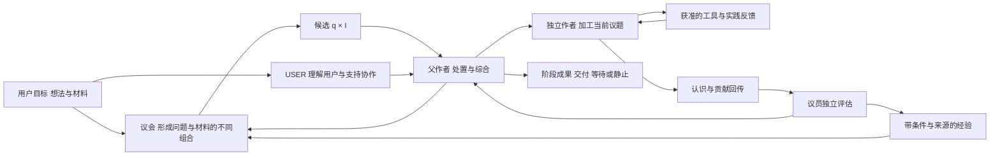

# Studio

Studio 探索怎样让用户与 Agent 在长期开发中共同形成、修订和复用设计认识。它尤其面向一种情境：用户想构建自己尚不熟悉的产品，一边开发，一边才弄清真正的问题、可行路线和判断标准。

当前实现是一个本地单用户协作工作台。用户给出目标、想法和材料后，议会形成可选问题与材料组合，独立作者加工，父作者汇合并修订认识；用户可以查看过程、回答问题、补充信息和纠正判断。设计产物可以直接交付，也可以为后续工程执行提供依据。

## 为什么需要 Studio

开发不只产生代码，也会产生意图、假设、反例、经验和新的问题。一个想法可能同时包含“为什么需要 Y”和“用 X 实现 Y”；X 失败并不能直接说明 Y 不值得保留，X 成功也不能证明背后的所有假设成立。对不熟悉领域的用户，这些区别往往是在与 Agent 共同工作时逐渐形成的。

Studio 的出发点是维护这些认识的含义与演化。保存聊天、代码和历史，可以让过去的信息重新被找到；后续仍需判断它当时是什么、现在是否适用、哪些部分可以迁移，以及新的实践结果改变了什么。原始历史与当前认识因此需要同时保留，并有明确联系。

这也解释了“工作室”与“实验室”的设想：前者维护仍在形成的问题空间，后者在当前问题空间中执行、观察和检验。两类工作都包含思考与行动，但需要的信息范围和处理方式可能不同。用户的探索历史不应未经理解就全部变成执行要求，工程日志也需要解释后才能成为设计经验。

例如，“要不要加一个 graph”可能表达的是“信息之间需要显式关系”，图数据库只是其中一种候选实现。Studio 希望让这个区别有机会被提出、加工，并在实践反馈后重新判断，而不是让最先出现的实现解释固定整个问题。

## 各个部件为什么存在

原始动机提出了需要解决的问题，并没有预先规定议会或父子作者结构。下表说明当前实现如何回应这些问题；这些机制能否改善长期认知质量，仍需要实际使用和比较来验证。

| 部件 | 设计目的 |
|---|---|
| 认知协议 | 说明不同认知工作为什么需要、如何加工、产物意味着什么以及由谁继续承接；使角色工作保留抽象问题、来源、条件与替代解释，JSON 输出格式只承担其中的结构约束 |
| 议会与 A/B 窗口 | 让抽象经验和当前场景以不同组合相遇，提出可改变问法的 `q×I`；议员独立提议，不按票数决定真理，也不只把父的解释拆成工程任务 |
| 父作者 | 对目标承担综合与取舍责任，处理候选、子贡献、冲突和未决问题，并据此修订自己的认识；父级位置不意味着更懂全部问题 |
| 子作者 | 为一段认知工作提供独立加工空间；可以展开、澄清、质疑、检验或重释父题，产出既可补充答案，也可改变父的前提 |
| 贡献评估与经验维护 | 从真实加工及反馈中区分抽象认识、具体实现和适用条件；保留负结果、原件与解释变化，让经验有条件地再用 |
| USER 协作议题 | 关注用户在过程中形成理解和表达的条件，提供可纠正的协作建议；保留用户原意、模型推断与真实互动的区别 |

父子关系主要规定修改与承接责任，不是认知高低排序。局部认识要真正回到上游，接收者必须说明怎样使用它；系统分别记录调用完成、材料送达和作者报告的采用，实际收益仍需后续反馈来判断。持久状态、版本、工具收据与恢复机制用于支撑这一工作链。

当前版本保存每个目标内部的工作历史和经验，不自动继承其他目标的任务经验或用户画像，也没有实现连接任意外部 Code Agent 的完整自动执行桥接。多角色数量、上下文长度和协议条目数本身都不能证明价值。更重要的检验是：相较于拥有良好 memory、上下文管理和项目文档的单一 Code Agent，能否更好地保留用户意图、利用失败经验、修订问题并形成可用成果。

完整动机、部件目的、示例与现状边界见 [设计动机与工作原理](docs/design-rationale.md)；具体运行协议见 [认知协议怎样参与运行](docs/cognitive-protocols.md)。

## 环境与平台

当前软件包为 `studio-workbench` 4.10.0，需要：

- Python 3.11 或更新版本。
- 已安装并登录、可从 PATH 调用的 Codex CLI，以及 `gpt-6-astra` 模型使用权限。所有角色固定使用该模型和 `xhigh` 推理强度，不会自动回退到其他模型。
- 安装时由 Python 包管理器取得 Pillow、pypdf 和 tiktoken。离线词表随软件包提供，运行时不下载词表。
- 如需读取 PDF 页图，另行安装 Poppler 的 `pdftoppm`，放在 PATH 中，或将 `STUDIO_POPPLER_BIN` 指向其 bin 目录。

| 功能 | 平台与验证边界 |
|---|---|
| CLI、本机网页、状态存储和模型调用 | 按 Windows、macOS、Linux 跨平台设计；需要在目标机器验证 Python 依赖及 Codex CLI 兼容性，不代表所有平台组合均已完整验收 |
| 图片与 PDF 处理 | 依赖 Pillow、pypdf；PDF 页图还依赖 Poppler |
| Python 隔离测试 | 仅支持 Windows 上的 Codex 原生 MXC，按目标显式开启；macOS/Linux 不支持该执行器，没有无隔离回退 |

Provider 使用 Codex CLI 的 `exec`、`--ephemeral`、`--ignore-user-config`、结构化输出和原生事件记录等接口。项目目前没有声明已验证的 CLI 版本范围；Python 包安装成功或 `doctor` 显示已登录，都不保证模型权限、参数兼容性或实际服务可用。首次使用应在独立数据目录中以一个小目标验证，并记录所用 CLI 版本。

## 启动

在仓库根目录创建虚拟环境并安装。以下示例将运行数据放到仓库同级的 `studio-data`，避免把个人任务混入源码目录。

### macOS 与 Linux

```sh
python3 -m venv .venv
. .venv/bin/activate
python -m pip install .
export STUDIO_DATA_DIR="$(pwd)/../studio-data"
python -B -m studio_runtime doctor
python -B -m studio_runtime serve --port 8766
```

### Windows PowerShell

```powershell
py -3 -m venv .venv
.\.venv\Scripts\Activate.ps1
python -m pip install .
$env:STUDIO_DATA_DIR = Join-Path (Get-Item .).Parent.FullName "studio-data"
python -B -m studio_runtime doctor
python -B -m studio_runtime serve --port 8766
```

如果当前 PowerShell 不允许执行激活脚本，可以直接用 `.\.venv\Scripts\python.exe` 代替上述 `python`，无需修改系统执行策略。`py -3` 所选择的 Python 仍须满足 3.11 或更新版本。

打开 [本机工作台](http://127.0.0.1:8766)。示例统一显式使用 8766；不传 `--port` 时 CLI 默认端口为 8765。Windows 也可在已准备好 Python 环境后运行 `./启动Studio.ps1 -DataRoot ../studio-data`。启动器自身默认把数据放在脚本目录下的 `studio-data`，使用上述参数可保持示例的数据布局。安装后可用 `studio serve --port 8766` 代替模块入口。

`doctor` 检查 CLI 版本、登录、Python 依赖、词表和 PDF 渲染器，不调用模型。`doctor --sandbox` 会额外运行固定的原生沙箱探针。打开网页、查看状态或创建未运行的目标不会调用模型；点击“创建并开始运行”、执行 `run`、或在网页提交回答/附件时，系统会启动或继续相关模型工作。

默认数据目录是进程当前工作目录下的 `studio-data`。全局选项 `--data-root` 优先于 `STUDIO_DATA_DIR`。上面的环境变量只在当前终端会话中有效；打开新终端后需要重新设置，或为每条命令显式指定同一数据根目录：

```sh
python -B -m studio_runtime --data-root ../studio-data status my-task
```

### 模型消耗与本地记录

真实运行会使用已登录账户的模型额度，并可能产生费用。默认每个目标最多并发 6 个模型任务，可调至 1–32；该上限不限制目标的总调用次数或总 token 消耗。语义摘要、独立复核、用户协作和检索也会创建模型调用。暂停停止后续派发，已经开始的调用仍可能完成。

工作台在本机保存完整任务输入、附件、模型输出、工具记录和产物，但推理材料会发送给模型服务；开启联网检索还会发送公开检索查询。它不是完全离线应用。运行数据不应提交到公开仓库；报告问题时使用合成材料，并清理日志中的目标、附件正文、身份信息和本机路径。详见 [安全与隐私说明](SECURITY.md)。

## 使用流程

1. 描述目标或想法，补充已知条件；产物和完成标准尚不明确时，可以在工作中逐步澄清。
2. 查看议题、产物、执行结果和需要回答的问题。
3. 回答问题或补充想法；必要时指出目标或协作判断中的错误。
4. 必要工作结清后，查看交付物与仍待确认的条件。

议题提问可以附上实际文件，问题下直接提供“查看”和“下载”。下载后可在电脑任意方便的位置修改，再在该问题下选择文件上传；用“修改哪个版本”标明对应原件。主动提交新材料时，在“文件交流”中选择接收议题。无需查找或写入系统内部目录。文件列表分别显示收到、正文送达和议题承接状态，旧版本保留。[双向文件交流说明](docs/file-exchange.md) 包含格式、版本和读取边界。

CLI 支持相同的运行入口：

```powershell
python -B -m studio_runtime create --id my-task --goal "比较三种资料归档方案，给出取舍依据和实施清单"
python -B -m studio_runtime run my-task
python -B -m studio_runtime status my-task
python -B -m studio_runtime input my-task --text "所有资料必须保存在本机"
python -B -m studio_runtime run my-task
```

`create --run` 会在创建后直接运行；`--goal-file` 从 UTF-8 文件读取目标。所有模型调用固定使用 `gpt-6-astra`，推理强度为 `xhigh`，包括议会、作者、用户协作、经验维护、联网检索、上下文摘要及独立复核。不会继承本机其他模型或 effort 默认值。

## 并发与反馈合并

每个目标默认最多同时调用 **6** 个模型任务。创建目标时可选 1–32；进入目标后可在网页“本目标最大同时调用”中修改。设置保存到该目标，刷新、重启与继续运行会沿用；降低上限仅停止额外派发，不中断已开始的调用。不同目标的上限分别计算，依赖未满足的任务不会因为有空闲槽位而提前运行。

CLI 的 `--workers` 设置新目标的默认上限，网页服务也接收此参数。例如：

```powershell
python -B -m studio_runtime --workers 6 serve --port 8766
```

父议题按一次决定实际派出的子题版本建立有限反馈批次，普通回传通常等同批子题及评估齐备再合并。用户输入、明确的紧急通知、需要父决定的议会结果或受阻子题允许提前处理；未返回责任会列在任务包中，不能借此提前完成。已返回的执行结果先逐条持久导入，再推进后继调度；迟到结果进入下一次封存输入。经验维护和用户画像整理的行政完成不会无条件触发 ROOT。详见[调度与反馈协议](docs/scheduling.md)。

## 运行结构

下图描述当前实现中的主要工作关系。它可以反复咨询、重铸和回传，不要求每个目标按固定阶段流水线走完；初始化会直接根据用户目标形成第一轮议会咨询。



ROOT 承担用户的当前目标。议会以当前处境、父的暂定解释和显式材料为起点，让议员从各自的 A/B 材料提出 `q×I`：`q` 是值得加工的问题，`I` 是与它共同形成加工条件的材料。问题和材料可以一起调整，不预设父的问法就是唯一正确的问法。父作者决定采纳、按有据的功能冗余拒绝，或向上级传递；采纳既可产生独立子题，也可在父本次实际工作中局部处理。

子作者的作用不限于任务分解。它可以挑战前提、提出竞争解释、发现新关系，也可完成明确的工程或认知工作。`ans` 保留本题当前认识，`con` 向父传递继续加工所需的关键变化、反例、条件和未知，逐项贡献支持有范围的评估。父作者仍须将这些反馈放回自己的问题中综合，不能把子题完成或评估充分直接等同于整体目标完成。

每次模型调用都使用新的临时进程和显式任务包。议员的 A 窗口提供抽象认识、方法与经验，B 窗口提供当前场景和观察；有界选材既服务于不同材料接触，也受物理容量限制。选材使用字面相关性和探索机会，语义判断由模型负责。软件检查来源、用途、受众与字符预算，但不能据此证明视角足够独立或注意力分配最优。

[认知协议](docs/cognitive-protocols.md)按具体操作说明语义背景、原理、输入含义、加工方法和结果承接。22 种操作引用 48 项通用设计的完整正文，目的在于把问题形成、认识加工、实践反馈和经验再用接起来。每次加载本操作与明确依赖，计入完整输入预算，并核验版本、正文和哈希；应用协议与可为空的任务经验库分开，不依赖旧会话或开发资料。

作者还可请求独立开放加工、重新解释与比较、组合评审、经验差异分析、影响分析和接续判断。重新解释先暂退旧解释，实际形成新产物后再比较，以保留摆脱既有框架的机会；它不能保证完全无偏。返回交回原责任者，由其明确说明怎样采用、保留或不采用，再形成后续工作。

工作流、版本、调度意图和返回结果保存在 SQLite。模型判断内容及停止理由，软件检查输出结构、对象版本、作用范围和重复处理。经验维护保留原始记录，追加关系、修订、条件与不同解释；一次实现失败不会自动删除相关抽象认识，一条记录存在也不会自动赋予它当前事实资格。

已有阶段成果可以先交付，未解依赖继续等待。工作台区分阶段交付与正式交付，队列为空不代表目标完成；旧交接、已返回工具和无变化轮询不会触发重复调用。专项核对使用实际原件和明确清单，逐项返回差异、无差异或材料不足，再由请求议题承接。详见[调度与反馈协议](docs/scheduling.md)。

## 用户协作

USER 是 ROOT 下的固定议题，负责有条件地理解用户能力、需求、偏好、潜力，以及怎样提供有效的思考起点。它在出现新观察或收到咨询时工作，其余时间休眠。未得到回答不代表用户能力不足，也不会自动阻止其他工作。

系统分别记录问题提出、实际呈现、收到回答及作者报告的采用。模型建议不等于用户回答，采用记录不等于建议已产生实际收益。用户明确表达的要求优先于模型推断。

回答原问题时指定问题 ID：

```powershell
python -B -m studio_runtime input my-task --question QUESTION_ID --text "我的选择是……" --profile-scope collaboration
```

CLI 操作者实际展示问题后，可用 `presented my-task QUESTION_ID` 登记呈现。网页会在实际展示后登记。

协作用途可选择：

| 用途 | 行为 |
|---|---|
| `collaboration` | 可用于本任务的协作建议 |
| `profile` | 仅供 USER 理解用户 |
| `none` | 不用于画像与引导学习 |

原答仍进入对应任务议题。USER 只接收获准内容；形成的方法和观察按用途、受众及情境进入议会窗口，不广播全量画像。可以用 `input --topic USER --correction` 或网页向 USER 提交纠正。

如需在创建时提供已获准的协作信息，使用 `--profile-file` 指向 JSON 文件。文件结构为 `{"seeds": [...]}`；每项必须有 `source`、`content`、`allowed_uses` 和 `audience`。例如：

```json
{
  "seeds": [{
    "source": "human",
    "content": "本任务中请先给出具体例子，再解释术语。",
    "allowed_uses": ["profile", "collaboration"],
    "audience": ["USER", "author:ROOT"]
  }]
}
```

此示例只是输入格式，软件不会自动加载。能力与引导效果的假设需要实际互动持续校正。

## 工具与产物

默认工具支持本运行产物目录中的文件信息、文本分析、范围读取和严格 JSON/schema 检查。原件目录及取回接口只开放该次调用获准的内容。工具请求、真实执行结果和模型采用分别记录；文件生成不代表执行或验证完成。

需要外部资料时，作者通过 `web.search` 请求独立检索调用，由 Codex CLI 原生搜索执行。默认 `live` 实时检索；网页创建目标时可改为缓存检索或关闭，CLI 可用 `create --web-search cached` 或 `create --web-search disabled`。每次普通认知调用仍禁止直接联网；检索调用只获得公开查询、用途、来源域名限制及检索协议，不继承议题会话、经验库或用户画像。

原生查询、打开页面动作、实际返回片段和时间保存在调用记录中；模型的摘录与归纳单独标明。结果进入请求议题，要求作者说明采用、保留或不采用及影响；后续作者与议会可按来源引用复用，`web.read` 支持按范围读取原生事件，无需重复搜索。网页的“检索来源”提供可点击出处。[联网检索协议](docs/web-research.md) 说明接口、保存内容和能力边界。

Windows 可按运行启用隔离 Python 测试：

```powershell
python -B -m studio_runtime doctor --sandbox
python -B -m studio_runtime create --id code-task --goal-file task.txt --sandbox-tests --run
```

执行器将明确选中的文本代码复制到独立目录，先用固定探针检查环境，再使用 Codex MXC 运行 Python 标准库 unittest。网络关闭，只有测试目录可写；允许解析宿主安装程序的路径联接，但任务文件仍禁止联接和符号链接。环境不支持时明确返回执行前失败，不切换为无隔离执行。

网页“Python 隔离测试”提供环境检查、失败诊断、实际输出、议题承接状态和显式重试。重试创建新执行记录并核验同版输入，原结果保留；执行结果不明时需要确认。未启动或结果不明的测试会留下可见的待恢复事项，议题可以等待该事项，不能将其当作完成。详见 [Python 测试执行与恢复](docs/python-tests.md)。

本版本使用新的阶段交付和认知输出契约，请重新创建目标开始工作，不将旧版本的运行记录作为本版本的续跑数据。同版本内重启可继续使用原数据目录。测试失败不会自动重复执行；环境检查通过后，在测试记录上选择“重新执行测试”。若文件已更改，应由议题为新版文件创建新请求。

联网检索依赖本机 Codex 登录、模型服务及原生搜索可用性，无法访问的页面和未返回的正文会明确保留限制。当前工具集不包含任意外部服务、通用 shell、GPU 训练或部署。隔离测试有时间和输出上限，尚无完整 CPU、内存、磁盘配额。

## 暂停、恢复和检查点

```powershell
python -B -m studio_runtime pause my-task
python -B -m studio_runtime run my-task
python -B -m studio_runtime retry my-task JOB_ID --reason "检查失败原因后重新调用"
```

暂停停止新派发，并保留在途结果。网页提交回答或附件会恢复该目标并继续运行，包括解除显式暂停；CLI `input` 仅保存输入，需要随后执行 `run`。中断后使用同一数据目录和运行 ID 接续；已启动但结果未知的调用不会自动重发。明确接受可能重复的调用时才使用 `retry --allow-uncertain`。

已确认的网络/限流故障按 5、15、45 秒退避自动重试，仍失败时保留显式重试入口；执行结果不明不会自动重发。网络重试保留原任务，不注入虚构的输出错误。输出契约错误最多自动修正两次，持续错误进入待处理状态。这是故障修复界限，不是认知探索轮数限制。

任务包自身的输入责任矛盾会在模型调用前拦截，并从当前授权材料重建。分批调用分别声明本批必须承接与后续仍待处理的输入；以前送达过但尚未处理完的材料仍为必需输入。不会通过省略承接义务、放宽来源校验或重复调用同一矛盾任务来恢复。详见[上下文与故障恢复](docs/context-and-recovery.md)。

回答提交后继续显示原问题、回答和处理进度。系统分别记录已保存、上下文整理、议题处理、仍需后继和已明确处理；未承接的输入不能被交付或静止绕过。文本和文件提交都支持幂等重试。

先去除同次调用中的重复正文并计量完整输入；原文可容纳时不会仅因历史增长而压缩。必需材料超过容量时才启动独立语义整理与覆盖复核；能容纳后停止，不能有效缩减的单元保留原文并复用失败结论。压缩失败保留原文，不用截断伪造完成。组装阶段的阻塞即使尚无 job 也显示在恢复面板中；可使用 `recover` 重查，或通过 `recover --context-policy policy.json` 调整策略。详见[上下文与故障恢复](docs/context-and-recovery.md)。

```powershell
python -B -m studio_runtime export my-task snapshots/my-task
python -B -m studio_runtime verify snapshots/my-task
python -B -m studio_runtime restore snapshots/my-task --id inspection
python -B -m studio_runtime fork snapshots/my-task --id next-task
```

`export` 保存数据库、原始输入输出、工具收据和产物；`verify` 检查完整性。`restore` 创建只读检查副本。`fork` 只接受同机真正静止的检查点，创建独立的可运行副本，保留来源身份，不重放已经执行的调用。含在途或不确定外部副作用的迁移需要人工处理。

## 能力边界

这是本机单用户软件，不提供多租户认证或跨系统实时撤权。模型可能遗漏问题、重复核查或产生错误判断；来源和记录支持追查，但不能自动保证认知质量、引导效果或任务成功。语义摘要经过独立模型复核，但不保证绝对无损；精确判断可以回查原件。长期原始数据仍会增长，需要磁盘空间；跨库语义检索和复杂外部执行不在当前工具集内。

## 部署内容

- `studio_runtime/`：运行代码、网页资源、认知协议和离线词表。`protocols/` 与 `tokenizer_data/` 都是运行依赖，部署时必须完整保留。词表附带来源信息与许可，不需要运行时下载。
- `docs/`：认知操作、协议语义背景、上下文组装及结果承接的完整说明。
- `pyproject.toml`、`MANIFEST.in` 与 `README.md`：软件安装配置、源码分发清单和使用说明。
- `LICENSE` 与 `THIRD_PARTY_NOTICES.md`：项目 MIT 许可和第三方资源说明；打包配置会将许可文件纳入分发。
- `启动Studio.ps1`：Windows 启动入口。
- `tests/`、`CONTRIBUTING.md` 与 `SECURITY.md`：回归与验收、贡献流程和安全边界，随源码分发保留。

复制上述内容并安装所需依赖后即可从源码运行，也可使用 `pip install .` 安装。运行数据由 `--data-root` 或 `STUDIO_DATA_DIR` 单独指定。本版本采用 4.10 的工作状态、依赖和归档格式，请创建新的目标开始工作；同版本内重启和静止检查点恢复保留原件、输入回执与未完成责任。

子议题的新用户任务先经过父议题协调，支持发布、复用、撤回和向祖先上报；已有答复通过明确的加工报告定向交接，接收者仍须实际读取与承接。详见[用户任务协调](docs/question-coordination.md)。上下文同时检查 token 预算与 CLI 单次输入 1,048,576 字符边界；已有超长失败输入会重新组装，历史原件保留。网页支持一次选择最多四个文件，并分别指定修改版本。

## 文档与贡献

- [设计动机与工作原理](docs/design-rationale.md)：原始问题、各部件的设计目的、当前机制和待验证价值。
- [认知协议怎样参与运行](docs/cognitive-protocols.md)：角色、操作及其承接关系。
- [认知操作完整参考](docs/cognitive-operations-reference.md)与[通用认知设计参考](docs/cognitive-protocol-reference.md)：完整协议语义。
- [调度与反馈](docs/scheduling.md)：并发、等待、阶段交付和唤醒。
- [上下文与故障恢复](docs/context-and-recovery.md)：输入责任、容量与长期记忆。
- [用户任务协调](docs/question-coordination.md)、[双向文件交流](docs/file-exchange.md)、[联网检索](docs/web-research.md)：用户和材料的实际流转。
- [Python 测试执行与恢复](docs/python-tests.md)：可选 Windows 隔离执行器。
- [回归与验收测试](tests/README.md)：离线测试、浏览器测试与真实模型验收的区别。
- [贡献指南](CONTRIBUTING.md)：开发环境、验证和提交要求。
- [安全与隐私说明](SECURITY.md)：本机服务边界与问题报告方式。
- [公开发布清单](docs/release-checklist.md)：发布文件、验证和版本检查。
- [第三方资源说明](THIRD_PARTY_NOTICES.md)：离线词表来源、哈希与许可。

源码运行不需要提交或携带 `build/`、`dist/`、`*.egg-info/`、`.validation/` 或已有 `studio-data/`。更改运行代码后，应在开发环境重新安装；协议、静态资源和离线词表必须与代码一起保留。

## 许可证

Studio 采用 [MIT License](LICENSE)，项目版权署名为 `Studio contributors`。

随包词表的第三方许可保留在 [LICENSE.tiktoken](studio_runtime/tokenizer_data/LICENSE.tiktoken)，该许可只适用于对应第三方资源，不代替项目自身的授权条款。
