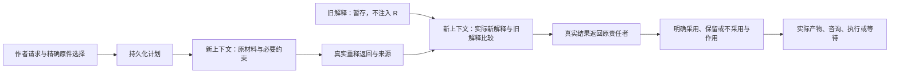

# 认知协议怎样参与运行

Studio 的原始问题来自探索性开发：用户不熟悉目标领域时，往往一边构建产品，一边形成对目标、问题和方案的认识。一个“用 X 实现 Y”的想法可能同时包含对 Y 的需求、尚未验证的解释，以及可以被替换的实现 X。若立即把整个想法变成工程任务，第一次实现就可能反过来固化问题；若只保存聊天和代码历史，X 失败后又可能连同仍有价值的思想一起被遗忘。

认知协议把这些需要写成可反复运用的工作语义：怎样形成问题、保留未成熟线索、区分来源与确定程度、加工材料、解释实际反馈，以及让下一位责任者继续理解和修订。它服务于意图与认识的演化。更长的上下文、更多历史和更多 agent 本身不能保证这件事做得更好。原始动机及当前实现范围见 [设计动机与部件目的](design-rationale.md)。

认知需求 `q`、用户 `U`、模型能力 `A` 与信息 `I` 共同影响信息前体 `p`。这个前体可以是一个问题、区别、反例、条件关系或局部方案，需要由接收者继续加工才产生作用。因此，保存信息、产生输出、形成认识、完成目标与长期协作收益要分别判断。

## 各部件为什么存在

| 部件 | 承担的认知责任 | 当前采用的机制 |
| --- | --- | --- |
| 认知协议 | 让独立调用理解这段工作的目的、材料含义及后续接收者，避免只按字段完成流程 | 操作正文及概念依赖随调用提供；输出 schema 另行约束结构 |
| 议会 | 为当前解释之外的问题和材料组合留下入口，避免只把父作者的问法分解得更细 | 议员在各自有限 A/B 材料下独立提出有来源的 `q×I`，也可请求材料或报告没有新方向 |
| 父作者 | 对本层目标组织认识与行动，解释候选和贡献怎样改变问题、约束或后继 | 逐项处置候选、接收真实回传、重新咨询或重铸议题，并承担整体交付判断 |
| 子作者 | 给一段获采纳的认知工作独立加工的空间，并把结果及其意义返回父题 | 围绕当前 q/I 工作，形成 ans、con 和贡献；可以发现反例、修订问题或请求再次咨询 |
| 贡献评估与经验维护 | 从实践中学习，又不把具体实现成败直接等同于抽象思想的价值 | 对实际贡献作有范围的评估，保存抽象与场景经验、条件、关系和后续修订 |
| USER | 在用户也正在理解领域的情况下，形成可校正的协作支持 | 依据获准交互区分原话、模型假说、实际呈现、回答与采用；不把模型建议当作用户偏好 |

议会的产物是供父作者处理的候选，不是票数或共同结论。不同议员也不只是固定专业岗位的任务分工：问题 `q` 本身可以变化，相关材料 `I` 也可以重新组合。A 窗口带入抽象思想、方法和经验，B 窗口带入当前场景与观察，让已有认识与新处境相互检验。有限窗口使每次提议的材料范围明确，给不同起点留下空间；它不证明视角真正独立，也不能保证发现重要问题。字符窗口与模型物理容量是不同约束。

父子关系说明谁承担哪段责任以及结果交给谁，不预先决定谁只能抽象思考、谁只能执行。子题的价值可以是回答父的问题，也可以是证明原问题有误、提出新的比较对象或揭示组合条件。父作者必须实际解释这些结果对本层目标的影响，不能只把子输出拼接起来或把多个“充分”相加。树的深度也不等于思考的抽象层级。

评估与经验维护让“这个实现失败了”和“背后的需要或原则不成立”有机会分别处理；反过来，实现成功也不能自动证明所有隐含假设。经验仍是带来源、条件和可修订状态的判断，保存不代表已经获得可迁移知识。当前经验按运行和议员作用域保存，新目标不会自动继承跨项目经验库。

原始 Studio 设想关注问题空间与执行空间不同的信息需求。当前实现以议会、作者、工具结果和反馈记录表达这种分工，没有要求每项认知产物都进入独立 Code Agent；认知成果可以直接交付，也没有实现对任意外部工程 agent 的自动调度桥接。

## 协议结构

- [认知操作完整参考](cognitive-operations-reference.md)：22 项操作，逐项说明为什么需要、何时发生、输入意味着什么、怎样加工、产物是什么意思、下一步交给谁。
- [通用认知设计参考](cognitive-protocol-reference.md)：48 项通用设计正文，包含十二类认知意图、十四类子父关系、联想、信息前体、学习、用户参与、停止与再次发现等。分类是可挑战的参考，不是完整性已被证明的分类学。
- `studio_runtime/protocols/operations.json`：软件加载的操作定义与概念依赖；`catalog.json` 保存全部概念。两份参考文档中的操作与概念正文展示对应的运行内容，文档导读另作设计解释。
- `cognitive_protocols.py`：根据明确操作生成完整协议包，校验依赖覆盖、版本与哈希。不是让模型临时决定删掉哪些规范。
- `cognitive_operations.py` 和 `cognitive_workflow.py`：具体操作的输入选择、输出结构、真实调用、结果保存和接收流程。
- `web_research.py` 和 `web_workflow.py`：原生检索的独立任务包、事件来源、持久调度及回到作者的承接。
- `file_exchange.py`：提问绑定原件、定向上传和版本关系、正文分段读取与实际承接；[文件交流协议](file-exchange.md) 说明调用组合及限制。

每次调用组合：通用目的和证据边界 → 这次操作的语义背景、方法和承接 → 该操作的完整概念依赖 → 当前真实任务和获准原件 → 输出契约。实际 JSON 字段排序仅用于稳定哈希；内容的语义关系由 `composition` 与操作正文说明，不能将 JSON 排序当作模型注意力控制。

完整设计保留在库内；一次调用不重复所有其他操作。`protocol.read` 可以读取任意操作的完整正文和依赖。新工作在派发前核对当前协议，已封存调用按自己的完整正文与哈希验证，不把新协议倒填旧证据。

这里的 22 种操作是可执行工作过程，不是认知需求的全集，也不替代十二类意图。一次 `open_processing` 或 `generate` 可以结合澄清、联想、表征、推演等不同意图；十四类子父关系则描述它为什么对父有作用。这三个维度分别回答“做哪段工作”“希望形成什么认识”“怎样影响父题”，不能混作同一套分类。

## 协议与执行契约如何分工

协议说明“要形成什么认识、为什么这样加工、结果还需要怎样被理解”；JSON Schema 说明“输出应包含什么字段及类型”；工作流检查“来源、版本、权限与责任是否允许这次状态变化”。三者共同工作，结构校验和幂等执行不能替代语义判断，也不能用一份符合 schema 的报告证明认知目标已经达成。

操作是可以按真实缺口组合的工作过程，既可以往返，也可以只使用当前所需部分。十二类认知意图、十四类子父关系及 48 项概念提供表达与质疑的起点，不要求逐类建任务或依次走完全部操作。一次比较、反例或负结果可能比增加一轮工程细化更有意义；何时探索、何时收敛仍要由责任者依据目标和实际材料判断。

## 常规调用如何组成工作链

下表按责任与触发整理常见调用，不规定单向流水线。实践返回可以改变先前的解释，并重新进入问题形成。

| 阶段 | 操作与角色 | 实际输入 | 返回怎样进入后续 |
| --- | --- | --- | --- |
| 初始化、再咨询 | `generate` / 议员 | 情况、观察、暂定解释、全局问题；私有库选出的 A/B 材料及明确请求原件 | 带来源 q×I 与选材请求进入父处置；不预先要求证明价值 |
| 正向处理、回泵综合 | `integrate` / 父作者 | 本批候选、真实贡献、fresh 评估、接收范围及未决责任 | 采纳、冗余拒绝、上报，或者咨询、工具、等待、交付；软件校验本批处置 |
| 议题工作 | `work` / 作者 | 当前 q/I、关系、获准用户输入和公开工作报告 | ans/con、逐候选贡献、文件和请求；新发现可以无归属 |
| 贡献回馈 | `assess` / 源议员或受邀者 | 实际返回、对应范围与原件 | 有条件充分性与 A/B 经验，回到父并进入经验原件库 |
| 经验维护 | `maintain` / 经验维护者 | 待处理原件、相关旧经验及条件关系 | 追加关系、修订、适用性、退休；原始记录不覆盖；以后选材再用 |
| 用户协作 | `collaborate` / USER | 获准的交互事件、纠正和明确咨询 | 条件画像与引导方法定向进入 A/B 或作者；真实使用与回答再形成事件 |
| 外部检索 | `web_research` / 独立检索执行者 | `web.search` 的公开查询、用途与来源限制 | 原生事件和模型报告分别保存，工具结果回到请求作者，经明确采用后进入后续产物与议会 |

父请求的 `inquiry` 可以是普通文字，也可以是包含 `situation`、`observations`、`interpretation`、`global_question` 的 JSON 字符串。结构化字段原样进入议会；普通文字使用实际父工作报告与用户目标作为有来源的接续背景。没有固定一句“还需解决什么”替代所有具体判断。

采纳分为 `adopt`（建立或重铸子题）与 `adopt_local`（父在本次 summary/files 中完成局部加工）。局部采纳保存实际作用、来源与产物路径，不为了流程另建子题，也不声称它已经过独立子贡献评估或形成长期经验。拒绝仍只用于有依据的功能冗余。

## 可请求的具体认知加工

作者和父作者的工具目录列出 `cognition.process`。这是新鲜上下文的模型工作，不是 shell 工具，也不会新建用户侧聊天窗口。可选操作如下：

外部检索使用独立的 `web.search` 入口，不能以 `cognition.process` 绕过搜索执行契约。其完整链路见[联网检索与材料承接](web-research.md)。

| 操作 | 返回的关键对象 | 接收后的责任 |
| --- | --- | --- |
| `open_processing` | 自由组织的认识、可为空的方向、未知 | 判断是否形成产物、问题或新的议会咨询 |
| `reinterpret` → `compare` | 实际独立解释、旧解释与逐项比较 | 决定采用、并存、重问或不采用 |
| `selection_review` | 已满足与未满足的材料请求片段 | 决定继续、重新取回或保留条件 |
| `joint_review` | 覆盖片段、未覆盖片段、组合依赖 | 父另作处理并安排剩余责任 |
| `experience_analysis` | 动作、理由、条件差异及可选综合 | 经贡献或维护流程决定是否入库，不能直接覆盖私库 |
| `change_impact` | 补充、事实修正、改问、用途变化及未知影响 | 局部修订、咨询、上报或保留；不自动全网广播 |
| `source_query` | 一次性的获准来源回答 | 判断是否进入 I；无子题、无侧网、无默认双向反馈 |
| `continuation` | 选项、预计作用、不选代价、选中后继、重开条件 | 通过常规接口实际做一次，再评价进展或未知 |
| `user_effects` | 用户信号的局部影响、可加工起点 | 形成实际问题或任务变化；不模拟用户答复 |
| `delivery_review` | 接收者、用途、可用部分、前提、缺口、再次发现支持 | 作者作最终交付判断，真实使用反馈再回流 |
| `handoff_review` | 每项旧义务的承接、吸收、失效或超范围判断 | 父确认新安排；报告不直接改 head 或结清义务 |
| `bounded_review` | 与明确清单一一对应的差异、无差异或材料不足 | 责任者明确承接逐项结果，再安排缺失材料或后继，不能用空候选替代核对 |

加工者提出语义判断，权限仍属于请求它的责任作者。以上操作不自动改写议题、不替代议会生成正式候选、不凭报告扩大受众，也不把语义建议自动执行为数据库变更。不同工作可以组合，但没有默认要求全部执行一遍。

## 输入选择

`cognition.process` 的 `arguments` 是 JSON 字符串，解析后包含：

```json
{
  "operation": "reinterpret",
  "brief": {
    "situation": "资料组织方式需要重新考虑",
    "observations": "同一资料有不同用途",
    "interpretation": "",
    "global_question": "应该围绕什么问题组织资料？"
  },
  "sources": [{"id": "artifacts/JOB.1/raw.txt", "pointer": "/artifacts/0/content", "window": "B"}],
  "constraints": [],
  "withheld_sources": [{"id": "artifacts/JOB.1/old.txt", "pointer": "/artifacts/1/content", "window": "B"}]
}
```

此示例不预装任何任务材料。指针必须从当前授权原始 `task` 中取得，不能猜文件或取其他上下文快照。省略的可选原件可先用 `context.catalog` 定位。投影可能重排数组，必须使用目录给出的原始指针；选择 artifacts 时 id 必须等于该原件的完整 path，软件验证二者一致才派发。选中内容的原文、来源 job、快照哈希、JSON 指针、内容哈希及祖先节点声明的用途/受众条件一并封入计划。

`brief` 是请求者的工作表述，不会升级成经过验证的事实。`constraints` 选择必须保留的事实或使用条件。A/B 字段只是声明用途，软件计量所有显式内容，但不能证明语义分窗或模型注意力比例正确。超限时保留原件和待办，要求显式改选，不静默摘要或截断。

## 独立重释、比较和结果承接

重新取回旧记录，未必能摆脱旧解释对材料的组织方式。`reinterpret` 先暂退旧解释，给实际材料形成另一种理解的机会；`compare` 再接回真实新产物与旧解释，保留前提差异、冲突和并存条件。这服务于认识修订，不要求新解释一定优于旧解释，也不能凭“独立调用”证明没有偏向。

有限核对采用相同的显式来源选择，并增加 `checklist`：例如 `[{"id":"C1","question":"这份配置是否包含超时值？","source_ids":["artifacts/JOB.1/raw.txt"]}]`。清单必须非空，每项有唯一 ID，所有 source_ids 均在本次真实 sources/constraints 中。仅写文件路径而未绑定正文不能声称已读。

返回的 `items` 恰好覆盖清单，每项给出 `changed`、`no_change` 或 `insufficient_material`、实际来源、finding 及 remaining。材料不足必须说明缺口；有结论的条目必须明确使用全部规定来源。返回工具结果包含原清单、材料来源与哈希、逐项结果及 `review_status`，责任者再用 input_uses 承接。结构验证不能证明判断正确；它防止漏项、引用未送达材料和用空结果冒充完成。



第一步不注入请求者的完整历史，也不自动注入目标全文，因为这些位置可能包含旧解释。软件检查被暂退的原文片段是否泄漏进第一步的任意显式字段。这个检查不能发现所有改写暗示，不能保证语义独立；选材者与 brief 本身仍可能带来偏向。

比较包必须来自已成功导入的真实重释结果，不能预写新解释或预写比较。结果过大时，已经发生的第一步保留成功状态，比较作为待处理输入问题公开留下，不重新采样来伪造一份更短的历史。完整比较不自动拆分；操作者可以使用 `compare-scope RUN REQUEST --selection-file selection.json`，明确指定 `result_pointers`、`old_source_ids` 和 `reason`。结果指针相对于真实重释的 output，旧来源 ID 必须来自原计划。软件保留完整原件、实际选中片段、原件哈希、未选择范围和选择原因，不用模型摘要替换原件；原有来源材料和必要约束仍保留。之后使用 `run` 继续，这是一项有范围限制的比较，不宣称覆盖完整输出。

返回经既有工具接口产生带来源的 `INPUT`，原责任者下一次显式看到它。对已看到的认知结果，`input_uses` 必须说明采用、保留或不采用及影响；可以明确无进展或效果未知。工作流保存这次承接以及实际后继请求/文件。未承接返回不能直接被“交付完成”越过。软件能检查实际调用与承接记录，不能机械证明判断正确、创新重要或用户获益。

## 持久化、恢复及验证

父和作者可看到本责任范围近期认知调用的执行/导入状态，并以 `cognition.status` 定位更早记录。这个视图不包含私有维护判断或完整画像；明确完成状态是为了避免把“看不到正文”误作“工作没有完成”，不能用它证明语义质量。

认知操作使用同一 SQLite 事务、工作队列、临时模型进程和返回导入规则。计划、调用、真实输出、比较依赖和接收记录都进入检查点。重复准备不重复创建调用；错误引用拒绝整笔语义导入；重试保留原始失败结果；当前版本变化后的结果按迟到原件保留，不能直接修改当前议题。

验证应覆盖三层：协议正文完整、实际输入和来源封装正确、真实返回确实触发后继并被接收处理。文本哈希与结构测试只能支持前两层；真实模型的完整工作链用于观察第三层。即使链条成立，也不能由单次验收推断普遍认知收益或最佳组织方式。

长期价值还需要以持续开发中的问题理解、抽象思想保留、实践反馈利用及用户可校正性来评价，并与拥有良好记忆、上下文管理和项目文档的单一 Code Agent 比较。调用更多、记录更完整或流程闭环本身，都不能证明 Studio 改善了长期开发认知质量。
