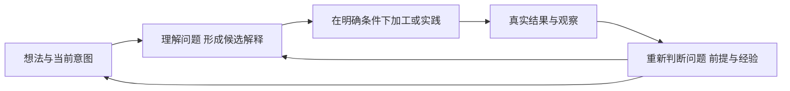

# Studio 的设计动机与工作原理

Studio 关注人与 Agent 在长期开发中怎样共同形成、维护和修订认识，尤其是用户正在构建自己尚不熟悉的产品时。此时，用户的意图、对领域的理解和评价标准，都可能随着讨论、实现和观察而改变。开发既生产软件，也生产关于“为什么这样做、目前知道什么”的认识。

原始设想提出的是一组问题与判断价值的标准，没有预先规定必须采用议会、父子作者或某组认知操作。当前项目以这些部件回应原始问题。下文分别说明原始动机、当前机制及其设计理由；机制存在不等于预期的认知效果已经得到验证。

## 1 从执行能力转向问题形成

随着 Code Agent 的代码理解、修改、测试与长任务能力增强，部分开发瓶颈可能转向更上游：用户究竟要什么，一句不成熟想法应怎样理解，哪些假设值得实践，过去的设计认识应该怎样继续发挥作用。

对熟悉领域的人，一些判断结构已经存在于经验中；对陌生领域的用户，这些结构往往在与模型共同工作时才逐步形成。模型不只参与实现，也会影响用户怎样理解产品。由此产生的建议、用户原话、实际发现和未经检验的解释，需要保留不同身份，不能因反复出现而逐渐混成“已知事实”。

用户提出“通过 X 实现 Y”时，至少包含两个可独立演化的问题：为什么需要 Y，以及 X 是否适合实现 Y。放弃 X 不必然意味着 Y 无价值；X 暂时奏效也不意味着其中所有隐含假设成立。Studio 希望为发现、保留和重新解释这种可迁移内核提供工作空间。

## 2 保存信息之后仍有工作

聊天记录、项目文档、代码、memory、检索和检查点，可以保存大量信息。原始动机并不以这些机制不足为前提，也不假定增大上下文就能解决或不能解决所有问题。它关注的是信息再次出现时，应该以什么含义参与当前判断。

例如，“使用某种技术构建动画系统”可能是用户偏好、候选技术栈、临时实现、失败实验，或一个抽象思想的载体。只找回原句，并不能确定它现在的作用。长期维护需要同时保留原始记录、当前解释、适用条件和改变解释的理由。

这里有两种可以并存的真实性：当时确实这样想过；现在认为它不再成立。保存当前结论不应抹掉历史，保存历史也不应让过时结论重新取得当前事实资格。失败记录也需要这种区分：它可能说明一个实现有问题，可能暴露原假设错误，也可能只表明某组条件尚未满足。

当前实现用不可变原件、版本、来源、条件化经验和当前工作认识承载这些区别。数据库与哈希能够支持记录追查，但不能替代对材料意义、适用性和迁移边界的判断。

## 3 工作室与实验室的关系

原始设想把外层信息与交互空间称为工作室，把面对工程、执行工具、做实验和检验结果的空间比作实验室。这个区分来自信息需求：维护一个仍在形成的问题空间，与在当前问题空间中执行，需要的材料范围和组织方式可能不同。

用户持续思考需要保留猜测、竞争解释、被否定的方向和仍不成熟的关联。具体执行则更需要当前有效的问题、约束、版本和证据。反过来，大量执行日志也需要经过选择与解释，才可能改变上层设计认识。

两者都需要思考与行动。工作室也可以形成可交付的比较、设计或认知产物，执行空间也会产生新的问题。理想的信息流是双向的：

当前 Studio 可以组织独立认知工作、生成文本产物、接收用户材料、调用有限工具，并把返回纳入后续认识。它尚未提供连接任意外部 Code Agent、自动修改任意工程并完整回收工程实践的通用桥接。认知产物本身可以交付，不要求每次工作都必须再进入一个外部执行层。

## 4 当前部件如何回应这些问题

### 认知协议让工作目的进入调用

如果每个角色只得到“处理任务并返回 JSON”，它可能迅速把探索压缩成一个可执行解释。认知协议为工作提供更具体的语义：为什么需要这项操作，输入应怎样理解，怎样加工，形成的产物可以主张什么，下一步由谁继续承接。

协议因此要让角色保留抽象问题、建设性替代、反例、条件和未知；允许改变问题，而不只是补足当前答案；也要求把观察、模型构想、用户决定和实际验证区别开来。JSON Schema 则检查字段结构，两者作用不同。符合 schema 不能证明完成了相应认知加工。

当前协议库包含 48 项通用设计与 22 种操作。通用设计包括认知意图、父子关系、回传、条件学习、用户参与和停止判断；操作将这些原则落实为 generate、work、integrate、assess、maintain、collaborate 及独立重释、比较、核对等工作。每次调用加载当前操作及其明确依赖的完整正文。

这些内容是当前设计的工作方法，不是任务事实、历史经验或已验证的认知定律。操作、认知意图和父子关系分别描述“做哪段工作”“希望形成什么认识”“它如何影响父题”，不应按分类逐项创建任务，也不能把条目覆盖当作认知质量证明。

详见[认知协议怎样参与运行](cognitive-protocols.md)和[认知操作完整参考](cognitive-operations-reference.md)。

### 议会为问题和材料提供不同组合

父作者已经形成的问法可能就是需要修正的对象。如果所有工作只围绕这一解释拆分，执行越有效，原有框架可能固化得越快。议会为此提供独立提议的机会：从当前情况、观察、暂定解释和材料出发，形成可以改变问法的 `q×I`。

`q` 是需要加工的问题，`I` 是使这项加工成为可能的材料。两者共同选择，是为了让“问什么”和“凭什么、从什么关系出发思考”一起变化。一份不同材料可能使原来的问题失去前提，也可能打开此前没有被问到的问题。

每位议员使用自己的有界 A/B 材料。A 偏向抽象认识、方法与经验，B 偏向当前场景和观察，让不同层次有机会相遇。有界窗口既是当前组织方式的一部分，也受执行容量约束；它不证明模型具有精确的注意力分区。经验差异、选材机会和新调用也不保证观点一定独立。

议会不采用多数表决，不以共识自动产生事实，也不要求每名议员永久充当一种专业工种。当前默认两种视角是认识边界与实践反馈，它们使用相同模型策略。候选可以展开、澄清、质疑、补充、联想或重新构造问题；任务分解只是其中一种关系。

### 父作者对综合与取舍负责

独立提议与子题结果不会自行组成有用成果。父作者要把它们放回当前目标，判断彼此的冲突、前提、组合依赖、未覆盖范围以及接收者真正需要的内容，再决定怎样继续工作。

父作者可以采纳候选、在本次实际工作中处理局部增量、按有依据的功能冗余拒绝，或向上级传递。它也需要接收反对原问法的贡献，必要时修订自己的认识或再次咨询议会。当前流程限制以“尚不成熟”为由直接淘汰候选，旨在为未成形的方向保留加工机会；这仍不意味着每个方向都应无限展开。

单父结构规定修改与承接责任，使结果有明确接收者。它不表示父比子更聪明、掌握全部材料，或天然拥有正确的问题。父作者本身也进行认知加工，并可通过 `adopt_local` 直接处理适合本地完成的工作，不必为了角色数量另建子题。

### 子作者提供独立加工和向上修正的机会

一个候选问题需要经过实际加工，才可能知道它是否有用。子作者承担一段有边界的认知责任，可以研究材料、形成比较、检验前提、提出替代解释、调用获准工具，或请求新的资料。它的价值可能是解出子问题，也可能是证明父的问题需要重写。

因此，父子关系不仅有分解，也有澄清、奠基、质疑、检验、联想、抽象迁移等作用。子题还可以再次咨询议会，成为下一层父题。层级表达责任，不能代替对实际认知作用的说明。

作者的 `ans` 保存本题演进中的认识；`con` 是供接收者继续加工的信息，应传回关键变化、条件、反例、竞争解释和对父 `q/I` 的修改意见。它不只是为减少 token 而压缩的结论摘要。逐项贡献可以关联原候选，也允许保留没有候选归属的新发现。

“回传”完成之后，父还要实际处理这些内容。系统分别记录生成、送达和承接，实际收益还需要真实反馈来判断，避免把信息搬运误当作认识已经发生变化。

### 贡献评估与经验维护保留不同生命周期

评估发生在真实加工返回之后，对指定贡献及可见材料给出有条件的充分性判断。提出候选的议员或显式受邀者参与评估，可以把结果反馈到原有经验；同时，协议要求允许反例、负结果和改变问题理解的工作成为贡献，避免只奖励符合原预期的答案。

抽象经验与具体场景分别提炼，是对“思想和实现具有不同生命周期”的直接回应。一次失败可以留下仍有价值的原则，也可能迫使原则收窄适用条件；一次成功也需要保留它依赖的局部条件。评估意见不是父作者的最终决定，更不是外部真实性认证。

经验维护进一步区分原始材料、关系判断与可复用整合表达。它可以追加冲突、局部支持、条件差异和修订，也允许没有统一综合，避免最新摘要成为未来唯一解释。以后是否真正被选用、怎样影响判断和实践，仍需要后续反馈。

### USER 支持共同形成认识的条件

不熟悉领域的用户未必能一次给出准确目标或评价标准。USER 的目的包括理解当前协作困难、寻找可供用户思考的起点，以及修订对需求、能力、偏好和潜力的假设。它应支持用户参与问题形成，而不是只提取一个静态偏好档案。

当前实现保留问题提出、实际呈现、真实回答和下游使用等事件，并按用途与受众控制协作材料。模型推断不能覆盖用户明确表达，没有回答也不能被解释为能力不足。引导方法被展示、获得回答或被作者采用，都不等于已经证明用户成长或因果收益。

USER 在没有新观察时休眠，用户的弱参与也不应自动阻止其他获准工作。系统对用户的解释必须可以被用户纠正。

### 原件 状态与恢复支撑认识的连续性

版本、来源、不可变输入、工具收据和责任账本，使后继调用能辨认：这是原始表达、模型解释、已发生结果，还是仍待处理的请求。它们也让问题改变后仍能检查旧义务怎样被承接，而不因重铸就抹掉失败或欠交付。

上下文压缩只处理容量问题；条件化经验维护则处理意义、关系与适用性。前者不能代替后者。当前语义摘要保留源范围并经过独立复核，但不保证绝对无损；需要精确判断时仍要取回原件。

这些基础设施为长期思考提供连续性。它们本身不能决定什么值得保留、抽象是否准确、何时应停止探索，相关判断仍需模型与用户在具体工作中作出。

## 5 一个贯穿的假设示例

以下是用来说明设计目的的假设情境，不是已经执行的项目验收。

用户正在开发资料管理工具，提出“是不是可以加一个 graph”。一种可能的工作过程是：

1. **保留原话并形成竞争解释。** 需求可能是展示关系、保存证据关联、追踪认识演变，也可能只是希望更容易导航。先把这些解释与“采用图数据库”这一实现候选区分开。
2. **议会形成可加工的问题与材料组合。** 一个候选比较用户难以找回的真实资料实例，另一个候选检查“关系”究竟属于资料、观点还是使用场景。材料差异可能改变问题本身。
3. **父作者选择并承担遗漏责任。** 父可以先采纳澄清工作，也可以用一个小原型检验当前解释；决定必须保留依据、未选方向和可推翻条件。
4. **子作者完成独立加工。** 可能得到的认识是：用户需要保留观点与证据的关系，但尚无证据表明图数据库是必要条件。这个结果会改变父原先的工程化问法，而不只是给它增加技术细节。
5. **实际实践产生新观察。** 如果之后有获准执行或用户提供的真实原型结果，可能发现关系视图有帮助，但维护边的负担过高。只有真实返回才能记为观察，推演结果应保留为假设。
6. **分别更新不同层次。** “这个图数据库方案在当前规模下成本过高”是局部实现经验；“观点与证据需要可追溯联系”可能仍值得保留，也可能需要更严格的适用条件。两者不合并为“graph 方案失败，所以关系不重要”。
7. **重新理解并交付。** 父把反馈组织为当前设计、未知和下一步；用户看到结果后也可能修订自己的需求。可交付物可以是一份关系定义、比较报告或验证计划，不必总是新增代码。

这条链的价值不在于每一步多调用一个角色，而在于是否减少了不必要的固化、保住了有用区别，并让真实结果改变了后续认识。若一个直接调用已经能充分完成这些工作，就没有理由为形式完整强行增加流程。

## 6 当前实现与原始愿景的距离

| 原始关注 | 当前机制 | 仍需保留的边界 |
|---|---|---|
| 不成熟想法不被过早工程化 | 可改变问法的议会候选、独立加工、重释后比较、用户纠正 | 选择材料与提示仍可能带入偏向；不能保证消除过早收敛 |
| 抽象思想与实现分别演化 | A/B 材料、条件化评估、关系与适用性维护、版本原件 | 抽象是否正确、能否迁移仍是待检验判断 |
| 实践结果反向改变问题 | 工具结果、文件反馈、贡献回传、父综合、改题与重铸 | 外部执行范围有限；没有任意工程执行器的通用自动桥接 |
| 维护长期认识 | 每个目标内的经验、工作认识、历史取回、语义准备与恢复 | 当前新目标不自动继承其他目标的经验或画像，没有统一跨项目知识库 |
| 支持陌生领域中的用户 | USER 有条件理解、定向协作建议、真实互动与纠正记录 | 不能从交互链存在推断用户能力提高或方法有效 |
| 让协作优于单一执行链 | 议会、独立作者、父综合及显式承接 | 当前机制和离线测试不能证明优于良好配置的单一 Code Agent |

“长期”在当前软件中主要指同一目标内部可持续、可恢复的工作与认识演化。原始设想中的跨功能、跨项目迁移是进一步的问题，不能因目录里存在 memory 模块就宣称已经实现。

## 7 保留开放问题与评价标准

原始材料保留了几组尚无固定答案的张力：保留哪些历史、如何抽象又不扭曲原意、何时探索或收敛、模型主动整理如何服从用户意图，以及哪些认识可以跨情境迁移。当前流程给出可审查的尝试，不应把工程实现的存在当作这些问题已经解决。

后续评价应关注真实工作中的变化，例如：

- 用户原始意图与后来模型解释能否被区分，错误解释能否得到纠正。
- 一个实现失败后，有用的抽象认识和适用条件是否仍能被找到并正确再用。
- 新证据是否实际改变了问题、认识或选择，而不是只产生新的摘要。
- 用户是否更容易理解自己的选择及其依据，且没有被模型推断替代明确意愿。
- 形成的设计与工程成果是否足以抵偿额外的调用、等待和维护成本。

这些问题需要长期任务、真实反馈和适当对照来回答。对照对象应包括具有良好 memory、上下文管理和项目文档的单一 Code Agent。增加角色、保留日志、通过结构测试或完成一次演示，都不能单独证明 Studio 的长期价值。

运行机制见[认知协议](cognitive-protocols.md)、[调度与反馈](scheduling.md)、[上下文与恢复](context-and-recovery.md)；具体验证边界见[测试说明](../tests/README.md)。
